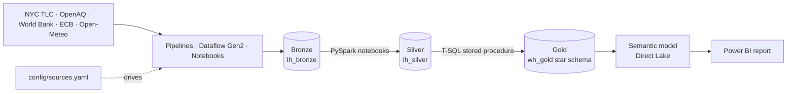
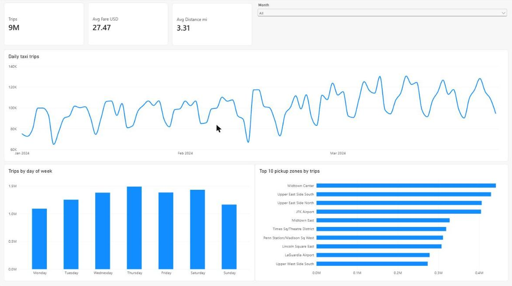
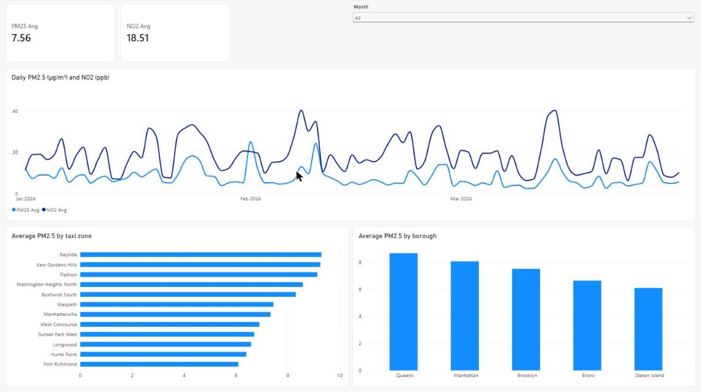
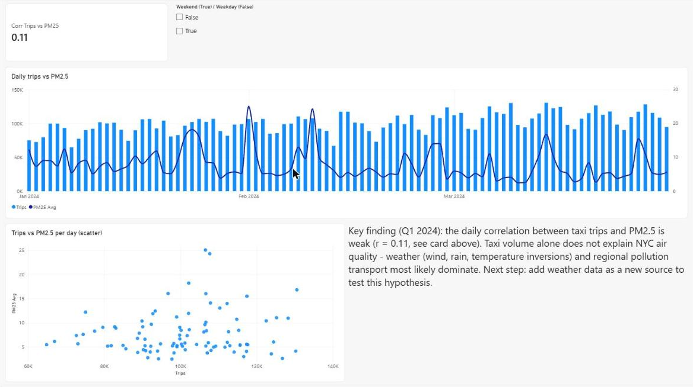
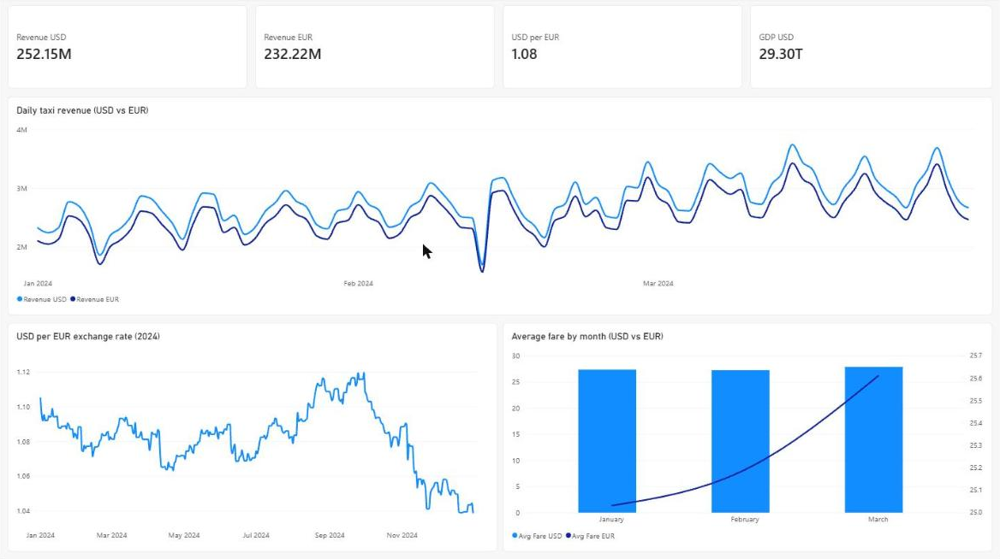

# Urban Mobility & Air Quality Analytics — Microsoft Fabric

End-to-end data engineering project on **Microsoft Fabric**: a medallion lakehouse (Bronze → Silver → Gold)
that combines New York City taxi trips, air quality, exchange rates and GDP. The result is a star-schema warehouse
and a Power BI report with automated daily refresh.

**Analytical question:** how does taxi mobility in NYC relate to air quality, and what does it look like in
economic terms (revenue in USD and EUR, macro context)?

## Architecture



| Layer | Fabric item | Content |
|---|---|---|
| Bronze | `lh_bronze` (lakehouse) | Raw files and raw Delta tables, unchanged from the source |
| Silver | `lh_silver` (lakehouse) | Cleaned, typed, conformed Delta tables |
| Gold | `wh_gold` (warehouse) | Star schema: `FactTaxiDaily`, `FactAirQualityDaily`, `DimDate`, `DimZone`, `DimFX`, `DimGDP` |
| Serving | `sm_urban_analytics`, `rpt_urban_analytics` | Semantic model (11 DAX measures) and a 4-page report |

## Data sources

| Source | Data | Ingestion |
|---|---|---|
| [NYC TLC Trip Records](https://www.nyc.gov/site/tlc/about/tlc-trip-record-data.page) | Yellow taxi trips (Parquet, monthly), taxi zones | `pl_ingest_taxi` (ForEach over a `months` parameter + Copy) |
| [OpenAQ API v3](https://docs.openaq.org/) | Daily PM2.5 and NO2 for stations in the NYC bounding box | `nb_bronze_openaq` |
| [World Bank API](https://datahelpdesk.worldbank.org/knowledgebase/articles/889392) | GDP, current USD (`NY.GDP.MKTP.CD`) | `df_ingest_macro` (Dataflow Gen2) |
| [ECB Data API](https://data.ecb.europa.eu/) | Daily USD/EUR reference rate | `df_ingest_macro` (Dataflow Gen2) |
| [Open-Meteo](https://open-meteo.com/) | Daily NYC weather (config-driven example) | `nb_bronze_generic` |

Loaded period: **Q1 2024** (taxi and air quality); FX from 2015.

## Orchestration and refresh

`pl_master` runs **daily at 06:00 (Europe/Warsaw)**:

1. In parallel: ingest taxi, GDP + FX, OpenAQ and generic (config-driven) sources.
2. `nb_silver_taxi` → `nb_silver_reference` (zones, air quality with spatial join, FX, GDP).
3. `dbo.sp_load_gold` reloads the warehouse.
4. The Direct Lake semantic model shows the new data without a separate refresh.

Each stage runs only if the previous one succeeded. A full run takes about 16 minutes.

## Report

| Page | Content |
|---|---|
| Mobility | Trips, average fare, distance; daily trend; trips by weekday; top 10 pickup zones |
| Air Quality | PM2.5 and NO2 levels; daily trend; PM2.5 by zone and borough |
| Mobility vs Air Quality | Correlation (r = 0.11), combo and scatter charts, weekend filter, key finding |
| Economic Impact | Revenue in USD and EUR, USD/EUR rate, GDP, average fare in both currencies |






**Key findings (Q1 2024):** 9.18 million cleaned trips; revenue 252.15 M USD (232.22 M EUR); average PM2.5
7.56 µg/m³ and NO2 18.51 ppb. The daily correlation between trips and PM2.5 is weak (r = 0.11), so taxi volume alone
does not explain air quality. Weather and regional transport are the likely drivers, which is the motivation for the
weather source.

## Extendability

The platform is metadata-driven. [`config/sources.yaml`](config/sources.yaml) registers every source, and
`nb_bronze_generic` ingests any source marked `loader: generic` (CSV, JSON or Parquet over HTTP) **without code
changes**. Weather data was added this way. Sources that need custom logic get their own loader and are
registered in the same file. Step-by-step guide: [docs/extending.md](docs/extending.md).

The Gold model is extendable too: a new fact table joins the shared `DimDate` and `DimZone` dimensions
through the same key conventions.

## Repository structure

```
config/       sources.yaml - source registry read by nb_bronze_generic
dataflows/    df_ingest_macro (Power Query M)
docs/         data dictionary, lineage, governance, extending guide, DAX measures, screenshots
notebooks/    nb_bronze_openaq, nb_bronze_generic, nb_silver_taxi, nb_silver_reference
pipelines/    pl_ingest_taxi, pl_master (JSON definitions)
sql/          wh_gold DDL, sp_load_gold and validation queries
```

## Documentation

- [Data dictionary](docs/data_dictionary.md)
- [Lineage](docs/lineage.md)
- [Governance](docs/governance.md)
- [Adding a new source](docs/extending.md)
- [DAX measures](docs/measures.dax)

## Deployment (fresh workspace)

1. Create a workspace on a Fabric capacity, plus lakehouses `lh_bronze` (schemas enabled) and `lh_silver` and
   warehouse `wh_gold`.
2. Upload `config/sources.yaml` to `lh_bronze/Files/config/`.
3. Import the notebooks from `notebooks/` and attach the default lakehouses. Put the OpenAQ API key into
   `nb_bronze_openaq` (it is not stored in Git).
4. Recreate `df_ingest_macro` from `dataflows/`, and the pipelines from `pipelines/`.
5. Run `sql/01_create_tables.sql` and `sql/02_sp_load_gold.sql` in `wh_gold`.
6. Run `pl_master` once, then enable its daily schedule.
7. Create the semantic model on `wh_gold` (relationships and measures from `docs/`) and the report.

## Source control note

Fabric's built-in Git integration is disabled in the university tenant (GitHub sync blocked; Azure DevOps needs an
Azure subscription). All items are therefore exported manually and versioned in this repository. Details are in
[governance](docs/governance.md#5-source-control).
