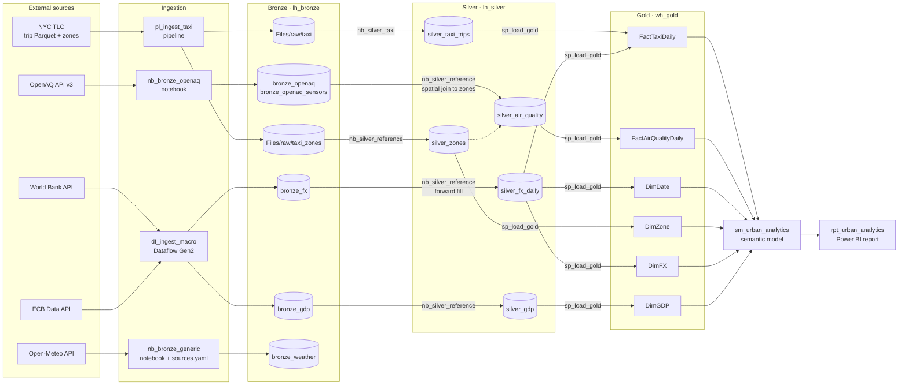
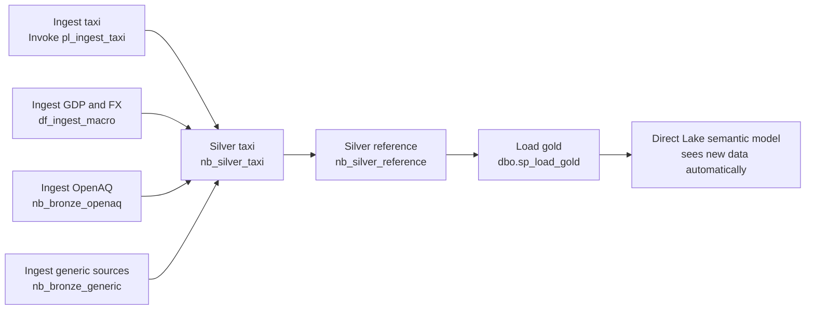

# Data lineage

The diagrams render on GitHub (Mermaid). The same lineage can be inspected live in Fabric:
workspace `ws-urban-analytics` → **Lineage view**.

## End-to-end lineage

`bronze_weather` stops at Bronze. It is the reference example of a config-driven source
(see [extending.md](extending.md)).

## Orchestration — `pl_master` (daily, 06:00 Europe/Warsaw)

All ingestion activities run in parallel. Each later stage starts only when the previous one succeeds,
so a failed source never produces a partially refreshed Gold layer. A full run takes about 16 minutes.

## Column-level lineage of key Gold fields

| Gold column | Derived from | Transformation |
|---|---|---|
| `FactTaxiDaily.trip_count` | `silver_taxi_trips` | `COUNT(*)` per pickup date × `PULocationID` |
| `FactTaxiDaily.total_amount_usd` | `silver_taxi_trips.total_amount` | `SUM` |
| `FactTaxiDaily.total_amount_eur` | `total_amount_usd`, `silver_fx_daily.usd_per_eur` | `SUM(total_amount) / MAX(usd_per_eur)` for the day |
| `FactAirQualityDaily.value_avg` | `silver_air_quality.value` | `AVG` per day × zone × parameter |
| `FactAirQualityDaily.zone_id` | station coordinates, `silver_zones` geometry | point-in-polygon join; `-1` when outside all zones |
| `DimFX.usd_per_eur` | `bronze_fx.OBS_VALUE` | cast to decimal, forward-filled over non-fixing days |
| `DimDate.*` | calendar of `silver_fx_daily` dates | date attributes derived in SQL |
| `DimGDP.gdp_usd` | `bronze_gdp.value` | cast, nulls removed |
